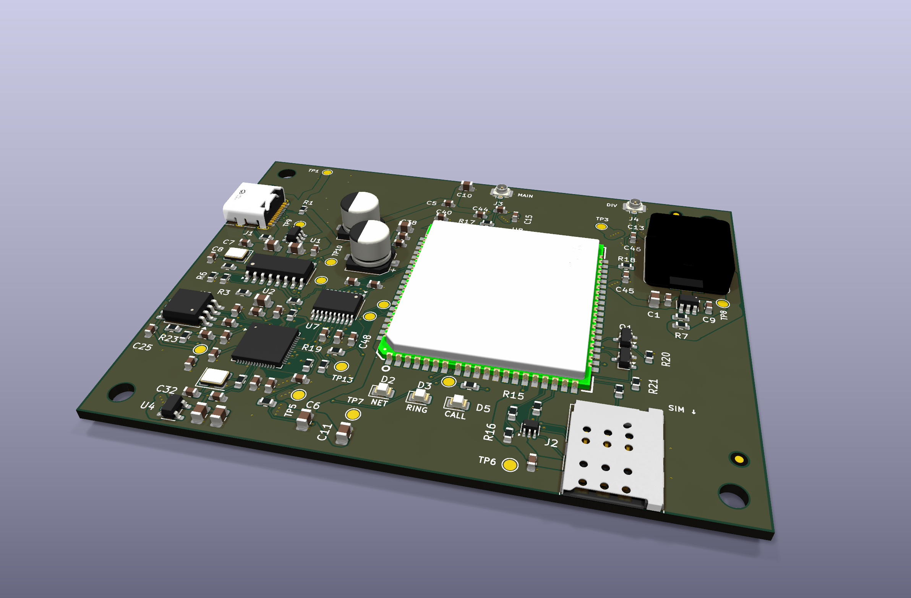
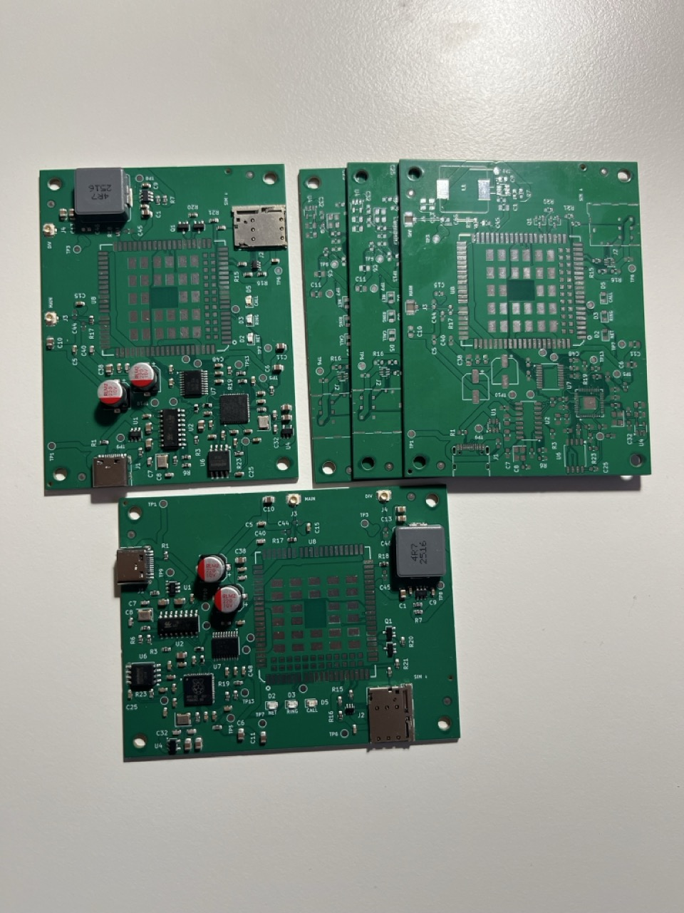
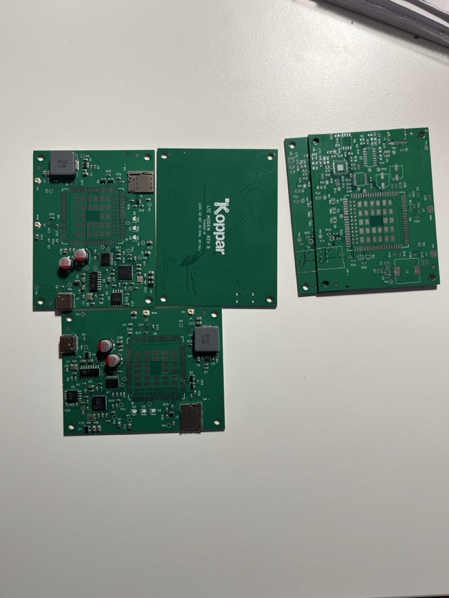
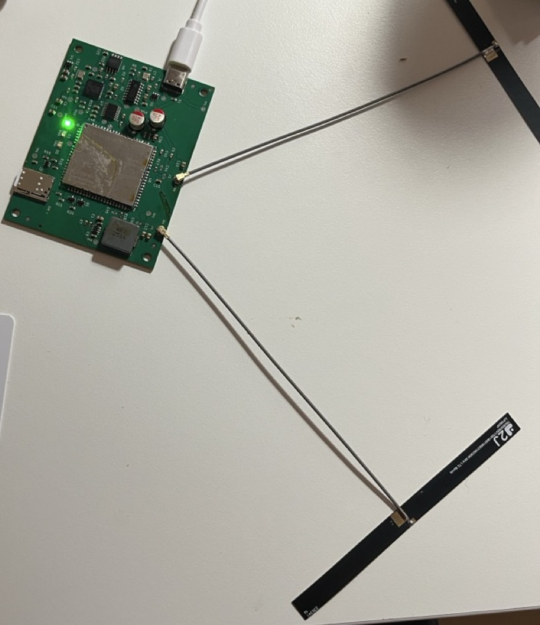
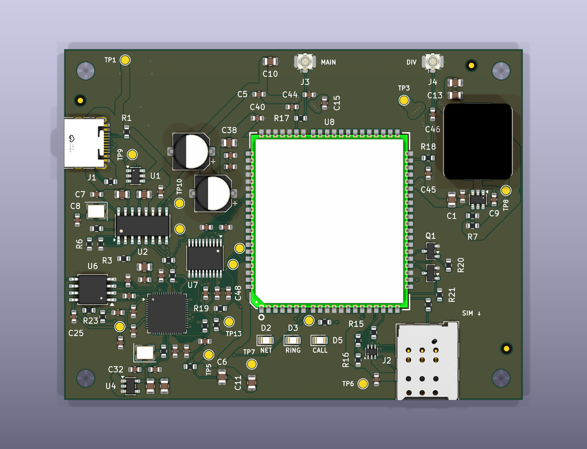
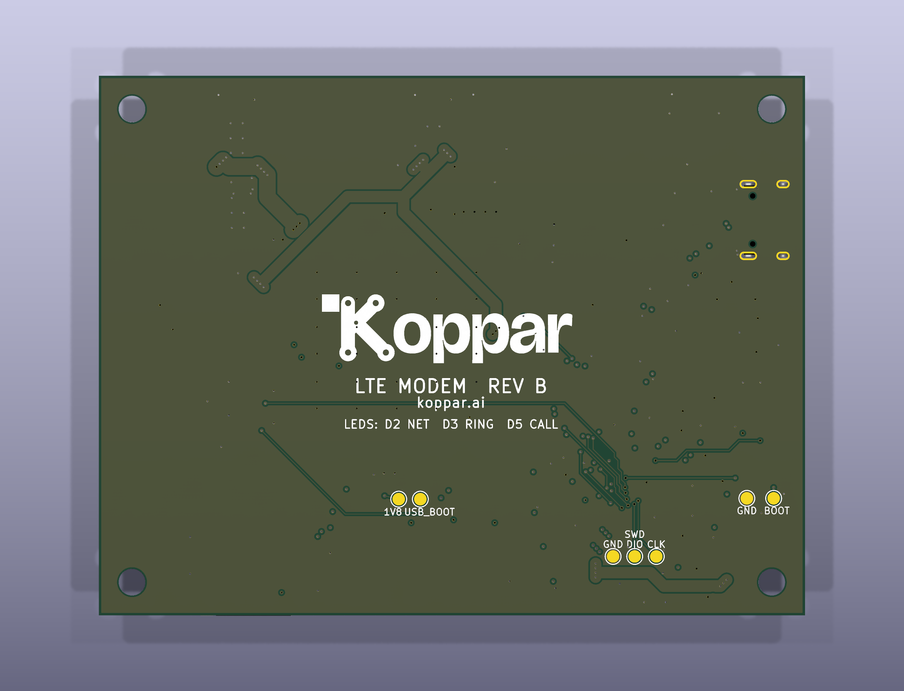
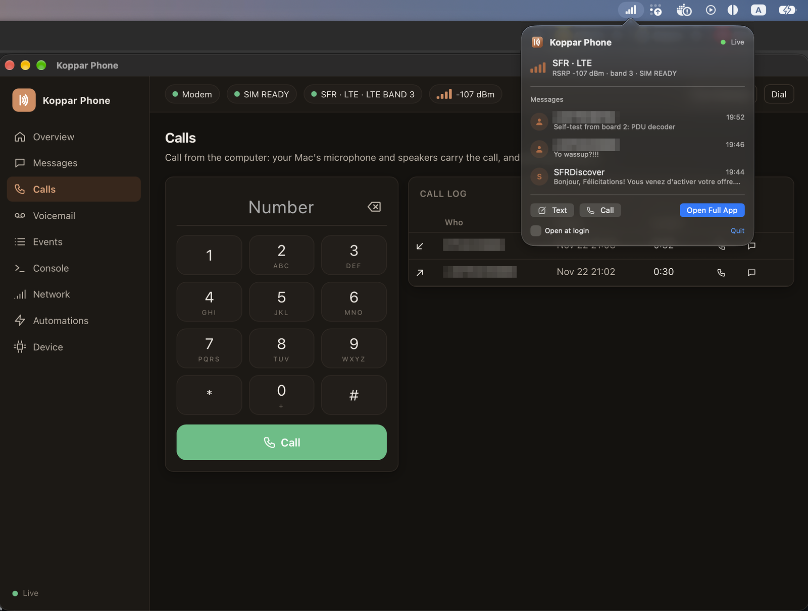
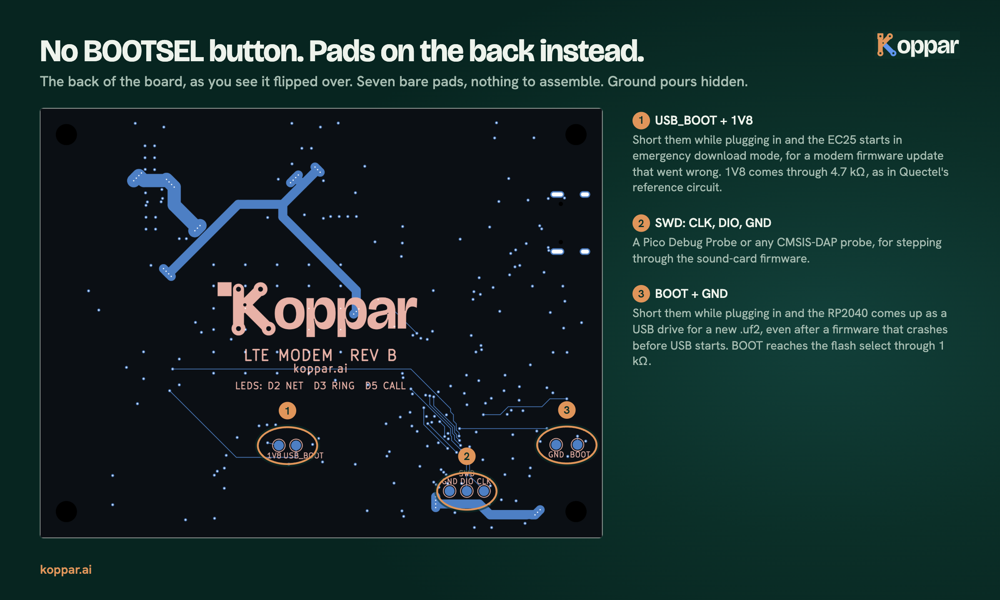
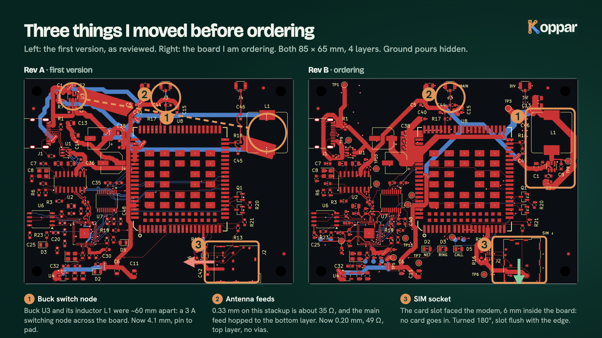

# Koppar LTE modem: a phone line over USB-C

A 4-layer board that gives a computer its own phone line: LTE data, SMS and voice
calls, with the call audio on USB. Plug in a nano-SIM and one USB-C cable, and the
computer can answer a call through your headset, hand it to a script or an AI agent,
or send a text.

The board was designed by [Koppar](https://koppar.ai/?ref=gh-lte) from a one-page
spec ([`spec.txt`](spec.txt)), then reviewed part by part against the datasheets.

## Built and tested

Rev B has been manufactured and assembled, and the assembled boards have been brought
up on the bench.

| Assembled boards and bare PCBs from the same batch | The back |
|---|---|
|  |  |

What has been tested on an assembled board ([all results](REVIEW.md#bring-up-results-2026-11-10-rev-b-ec25-not-yet-fitted)):

- **Power:** 5 V in over USB-C, the 3.3 V rail, and the 3.8 V buck for the module (3.90 V with no load, inside the module's 3.3 to 4.3 V range).
- **USB:** the on-board hub at 480 Mb/s, the RP2040 behind it, its flash and its 12 MHz crystal.
- **The module's controls:** the PWRKEY and RESET_N transistors switch, and the NET, RING and CALL LEDs light.
- **The firmware:** the RP2040 runs as a USB sound card on the computer. A test tone and a loopback come back at the expected level, the audio streams reopen reliably, and the firmware updates itself over USB.

**With the Quectel EC25-EUX fitted** (soldered by hand, with a SIM on SFR):

- **The module:** it starts on PWRKEY in about 3 s, appears on USB about 12 s later, and reads its own supply at 3.81 V under load.
- **The network:** registers on 4G (bands 3 and 20), with both antennas on the U.FL connectors.
- **Texts:** sent and received, including long texts in several parts and named senders.
- **Calls:** placed and answered, with two-way audio through the computer's microphone and speakers over the board's USB sound card. With VoLTE off, calls fall back to 3G.
- **Voicemail:** Koppar Phone answers missed calls, plays a greeting and records the message.

Board 1 started but didn't appear on USB after a second soldering pass: its module's USB pins (U8 69 to 71) need reflowing.

The boards of this first order have no recovery pads on the back
([see below](#bring-up-and-recovery)); the design files have them.

## What it does

One USB-C cable, and the computer sees three ordinary devices through the on-board USB hub:

| Device | From | For |
|---|---|---|
| Network adapter | Quectel EC25-EUX (U8) | LTE data, with 3G and 2G fallback (European bands) |
| Serial ports | EC25-EUX | AT commands: caller ID (`+CLIP`), texts (`AT+CMGS`), answer (`ATA`) |
| USB sound card | RP2040 (U5) | Call audio: the module's 1.8 V PCM interface, level-shifted, as a USB microphone and speaker |

There is no battery, screen or speaker. Three LEDs show NET (green), RING (amber) and
CALL (blue). Power is 5 V from USB-C, a 3.8 V / 3 A buck for the module's 2 A
transmit bursts, and 3.3 V for the hub, the RP2040 and its flash.

| Top | Back |
|---|---|
|  |  |

The [schematic](images/schematic.png) is also in [PDF](board/fab/schematic.pdf).

On a Mac, **Koppar Phone** puts the line in the menu bar: texts, calls on the
computer's microphone and speakers, voicemail, and the network in detail
([more](host/README.md#koppar-phone-the-menu-bar-app-macos)).

## What is here

| Path | What it is |
|---|---|
| [`spec.txt`](spec.txt) | The spec the board was designed from. |
| [`board/`](board) | KiCad 10 project: schematic, board, rules, the module footprint, symbol and 3D model. |
| [`board/fab/`](board/fab) | Gerbers and drill files (`gerbers.zip`), IPC-2581, schematic PDF. |
| [`board/fab/jlc/`](board/fab/jlc) | JLCPCB assembly BOM and placement files, with the part choices checked by hand. |
| [`REVIEW.md`](REVIEW.md) | The design review: what passed, what changed and why, ordering notes, what is still open. |
| [`REV-C.md`](REV-C.md) | What to change in the next revision, learned bringing up rev B. |
| [`firmware/`](firmware) | RP2040 firmware: `bringup/` (board test) and `modem/` (USB sound card for calls, module power, LEDs). |
| [`host/`](host) | `koppar-lte-modem`: command line, event daemon and Python API for the computer, and Koppar Phone, the macOS menu-bar app. |

## Build one

**Board.** Upload `board/fab/gerbers.zip` to JLCPCB: 4 layers, 1.6 mm, stackup
JLC04161H-3313 (the antenna feeds are 49 Ω on it). Every via is 0.45 / 0.2 mm and
none sits in a pad, so pick *Min via hole size 0.2mm/(0.3/0.35mm)* and *Via covering:
Plugged*: no via-in-pad, no extra options.

**Assembly.** Use `board/fab/jlc/BOM-JLCPCB.csv` and `CPL-JLCPCB.csv`. Glance at the
placement preview before confirming, especially the LEDs and the SIM socket
(the card slot is at the board edge). [`REVIEW.md`](REVIEW.md#ordering-notes-checked-2026-10-30-against-the-live-jlcpcb-catalogue)
lists the parts the files correct.

**Parts you source yourself.** These are not on JLCPCB's assembly line, or are not on the board at all:

| Part | What to get | Where |
|---|---|---|
| U8, the LTE module | Quectel EC25-EUX, ordering code **EC25EUXGR-128-SGNS** (EC25EUXGA-128-SGNS is end-of-life; same LGA-144 footprint). It must be the EUX: the North American data-only variants have no voice. | [Techship](https://techship.com/product/quectel-ec25-eux-lte-cat-4-lga), [DigiKey](https://www.digikey.com/en/products/detail/quectel/EC25EUXGR-128-SGNS/15516833), [Octopart](https://octopart.com/part/quectel/EC25EUXGR-128-SGNS) (stock changes, check the suffix). Deselect U8 at assembly and solder it with hot air or a stencil, or consign it. |
| 2 antennas | LTE, 698 to 2690 MHz, U.FL (I-PEX MHF I), 50 Ω: one on MAIN (J3), one on DIV (J4) | e.g. [Taoglas FXUB63](https://www.mouser.com/new/taoglas/taoglas-fxub63/) or [Taoglas FXUB62.07.0150C](https://www.digikey.com/en/products/detail/taoglas-limited/FXUB62-07-0150C/16610012) |
| SIM | A nano-SIM with a voice plan | Your carrier |
| Cable and port | USB-C on both ends, from a port that offers 3 A at 5 V | The 5.1 kΩ CC resistors make the board a sink; they negotiate nothing, so a USB-A port or a 1.5 A source will brown out in a 2G burst |

## Open it in KiCad

Open `board/koppar-lte-modem.kicad_pro` in KiCad 10. The module's footprint, symbol
and 3D model are in the project (`board/footprints`, `board/custom_syms`,
`board/models`), wired in by the project's library tables.

KiCad's library has no 3D model for two of the footprints, so the 3D viewer shows
them without a body:

| Part | Footprint | 3D model |
|---|---|---|
| J1, USB-C receptacle | `Connector_USB:USB_C_Receptacle_HRO_TYPE-C-31-M-12` | [LCSC C165948](https://www.lcsc.com/product-detail/C165948.html) (EasyEDA model) |
| J2, nano-SIM socket | `Connector_JAE:JAE_SIM_Card_SF72S006` | [LCSC C2977286](https://www.lcsc.com/product-detail/C2977286.html) (EasyEDA model) |

[easyeda2kicad](https://github.com/uPesy/easyeda2kicad.py) converts either one to a
`.wrl` you can attach to the footprint. The renders above use them.

## Bring-up and recovery

There is no BOOTSEL button. A blank RP2040 boots into its USB bootloader anyway, and
the back has three labelled pad groups for the rest:

- **BOOT + GND**: short them while plugging in and the RP2040 comes up as a USB drive for a new `.uf2`, even after a firmware that crashes before USB starts.
- **SWD (CLK, DIO, GND)**: a Pico Debug Probe or any CMSIS-DAP probe.
- **USB_BOOT + 1V8**: short them while plugging in and the EC25 starts in emergency download mode, for a modem update that went wrong.

Boards from the first rev B order were made from an earlier export and have none
of these pads. To force the RP2040's bootloader on one, bridge pins 1 (CS) and 4
(GND) of the flash, U6, while plugging in (a 1 kΩ resistor's legs, or tweezers),
then let go.

The modem does not switch itself on: the RP2040 drives its PWRKEY (GPIO22) and
RESET_N (GPIO23). Until the firmware runs, the computer sees only the hub and the
RP2040.

## The design review

The first version (rev A) had an antenna feed at 35 Ω that hopped
layers, a buck 60 mm from its inductor, and a SIM socket facing the wrong way. All
three are fixed here, along with the parts list and the assembly rotations.
[`REVIEW.md`](REVIEW.md) has every finding with its numbers.

## Status

| | |
|---|---|
| Board | Rev B: built; works with the EC25-EUX fitted: calls, texts and call audio ([results](#built-and-tested)). Board 1 needs its module's USB pins reflowed. |
| Firmware | USB sound card carrying call audio both ways, module power and reset, LEDs, updates over USB. |
| Software | [`host/`](host): the command line and daemon, and Koppar Phone for macOS (menu bar, call panel, texts, voicemail). Releases build it for macOS and Linux. |
| Next | Rev C ([`REV-C.md`](REV-C.md)): recovery buttons, the SIM drawn on the board, the module placed by the assembler, signed firmware updates. VoLTE on the module. |

VoLTE is optional on the EC25-EUX. Where 2G and 3G are switched off, calls need a
module firmware with VoLTE and a carrier that allows it; ask the seller.

## Design your own

This board started as a page of text. [Koppar](https://koppar.ai/?ref=gh-lte) takes a
spec like [`spec.txt`](spec.txt) to a schematic, a routed board, a BOM at live prices
and Gerbers. It also takes a KiCad board you already have, or works from your own
agent over MCP.

## Licence

CERN Open Hardware Licence Version 2, Permissive ([`LICENSE`](LICENSE)).
